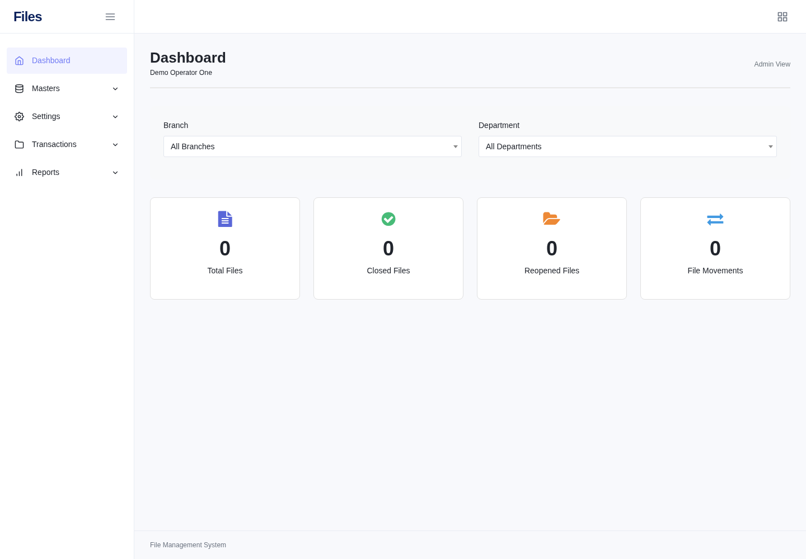
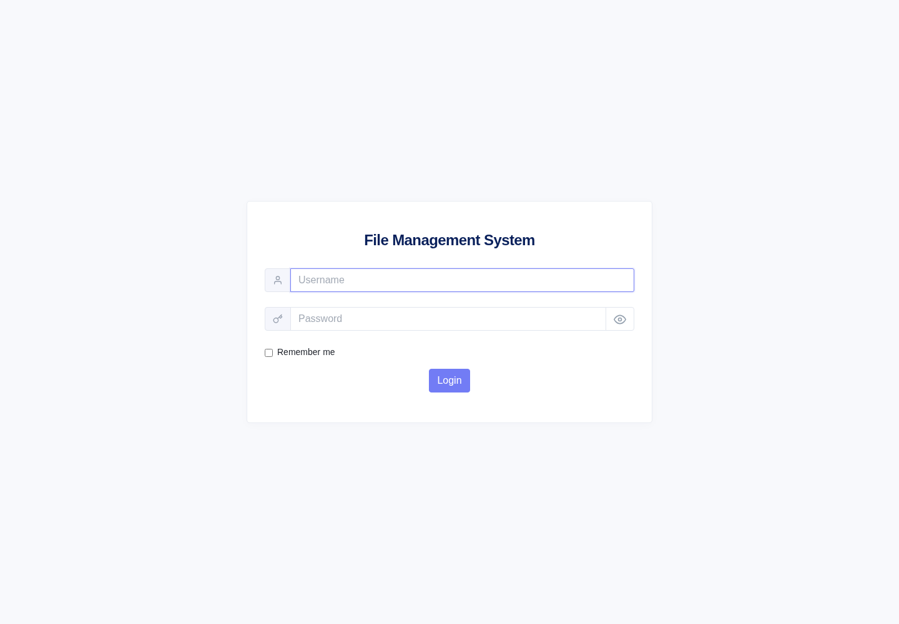
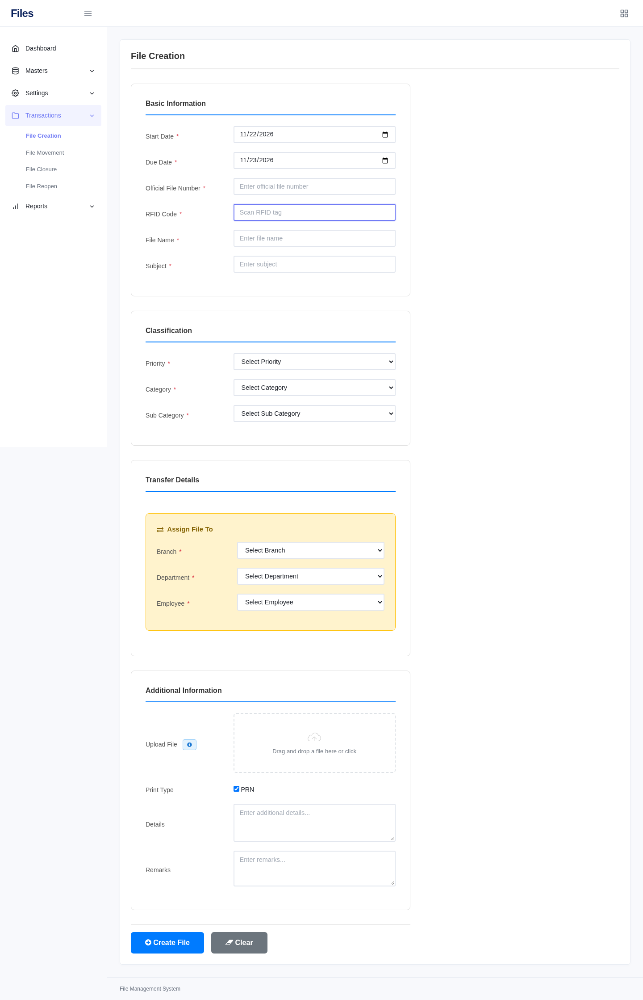
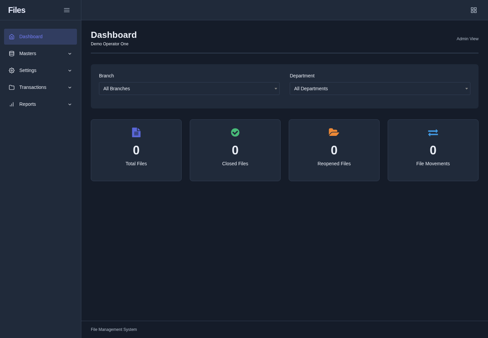

# File Management System

A Laravel application for tracking physical files across departments and employees. It supports RFID-tagged file records, movement and transfer, closure and reopening, and reporting.

This repository is a **local demonstration and source-review edition**, not a production deployment. It uses invented demo records. The original working application is separate.



## Features

- File creation with an official file number, RFID code, dates, classification, assigned employee and optional attachment.
- Movement tracking for Received, On Hold, In Progress and transfer to another employee.
- Current-holder checks in the tested movement workflow, plus closure and reopening.
- File reports, CSV and PDF export, attachment viewing/download and file history.
- Company, branch, department, employee, category, subcategory and user administration screens.
- Configuration, menu permissions, profile, password change and print-template screens.
- A separately written responsive interface with light/dark shell styles, mobile navigation and locally bundled browser assets.

Physical printing, RFID readers and scanner hardware have not been certified. See [validation and limits](docs/validation.md) for the exact checked scope.

## Screenshots

| Login | File creation |
| --- | --- |
|  |  |

All screenshots show invented demonstration data.

## Requirements

- PHP **8.2 or newer**. Validation used PHP 8.3.13. The existing locked dependencies have a higher effective minimum than the older lower bound in `composer.json`.
- Composer and the extensions required by `composer.lock`, including PDO SQLite, mbstring, XML/DOM, GD, ZIP, fileinfo, intl and bcmath. Check your installation with `composer check-platform-reqs` after installing dependencies.
- A new, disposable SQLite database for the documented setup. MySQL has not been validated in this edition.

The compiled browser assets are included. Node.js and an npm build are not needed to run this demonstration. The legacy npm manifest does not rebuild the replacement interface; its source is in `public/css/file-management.css` and `public/js/file-management.js`.

## Local setup

Use a new directory and an empty database. Do not point this copy at an existing or production database, and do not import an old SQL dump.

```sh
composer install --no-scripts --no-plugins
cp .env.example .env
touch database/database.sqlite
mkdir -p storage/framework/cache/data storage/framework/sessions storage/framework/views storage/logs
php artisan key:generate
php artisan package:discover
php artisan migrate
```

Composer reports PSR-4 warnings for retained legacy duplicate or backup classes. The checked install completes despite those warnings. They were not renamed or deleted as part of this focused demonstration cleanup.

The commands above use a Unix-style shell. On Windows, create the same empty file and directories with PowerShell or your file manager.

The example environment uses local mode, SQLite, debug disabled and the log mailer. Dependencies and runtime data are not committed.

### Create the invented demo accounts

Temporarily set `DEMO_PASSWORD` in your **local** `.env` to a password of your choice, at least 12 characters long. Do not send it in chat or commit it.

```sh
php artisan db:seed --class=DemoSeeder
```

Remove `DEMO_PASSWORD` from `.env` afterward. The accounts are `demo1` and `demo2`, using the password you chose. No preset usable password is shipped. The seeder runs only in local/testing mode and refuses a nonempty database.

```sh
php artisan serve --host=127.0.0.1 --port=8000
```

Open the local address printed by that command. Keep it bound to your computer. Do not expose this edition with a public tunnel or deploy it as a live service.

## Try the workflow

1. Sign in as `demo1`. Create a file with invented details and select the demonstration category, branch, department and employee. For this legacy demo, avoid filesystem special characters in the official file number.
2. Move the file through Received, On Hold and In Progress, then transfer it to Demo Operator Two.
3. Sign out and sign in as `demo2`. Check the transferred file, close it and reopen it to a demonstration employee.
4. Review File Report and File History. Try CSV/PDF export and a synthetic attachment.
5. The PRN label path and print popup are retained. Use only test material; real printer/scanner behavior remains unverified.

## Tests

Use a disposable in-memory database:

```sh
DB_CONNECTION=sqlite DB_DATABASE=:memory: vendor/bin/phpunit
```

Use your shell's environment-variable syntax on Windows. The checked suite passes **7 tests and 75 assertions**. It includes the scaffold tests, file lifecycle/report/attachment checks, the same-second movement tie-breaker regression, and empty-branding rendering. Test-only credentials are disposable fixtures, not installed demo logins.

Real-browser checks also covered login, dashboard, file creation, Configuration, password reveal and mobile navigation. An invented file was created through the form. These checks do not certify every CRUD/import/export branch.

## Security and legacy limits

- The project is locked to Laravel 9.52.20 and other legacy packages with known advisories. It is **not production-ready**. Laravel 9 is outside security support.
- A maintained deployment needs a supported-framework upgrade and an authorization, upload, path-handling and session/configuration review. Do not assume that a successful local test suite is a security audit.
- Unrelated warehouse-era routes/modules remain in the supplied application source. One physical-verification route references a missing controller, so global `php artisan route:list` is not currently clean. It was not silently deleted to conceal that limit.
- The migration repairs target fresh installations only, not upgrades of an existing database.
- Existing records, original uploads, company branding, credentials, repository history and runtime logs are not included.

See [SECURITY.md](SECURITY.md) and [validation details](docs/validation.md) before using the source.

## Third-party code and licensing

The uncertain template shell and unused template assets are excluded. The replacement interface source is included with this edition. Required browser libraries are pinned and their license notices are in [`third-party-licenses/`](third-party-licenses/) and [THIRD-PARTY-NOTICES.md](THIRD-PARTY-NOTICES.md).

No blanket MIT or other open-source license is asserted for the application as a whole. Third-party components keep their own licenses. See [LICENSE-NOTICE.md](LICENSE-NOTICE.md).

## Dark-mode preview



Dark-mode form surfaces were checked along with the light desktop and mobile views. The login page uses its neutral unauthenticated style.
